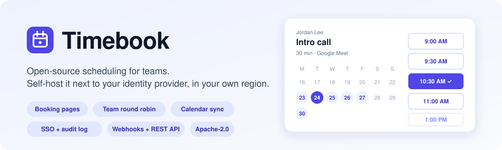
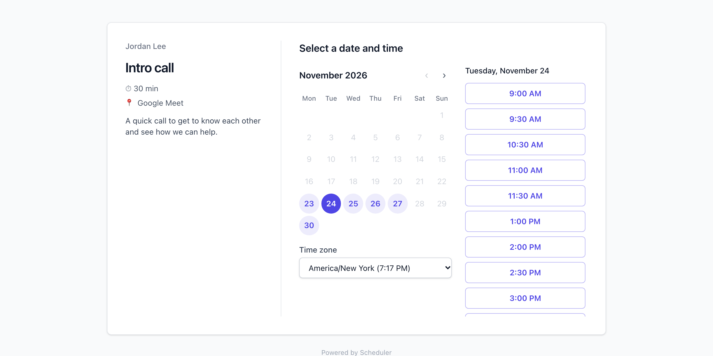
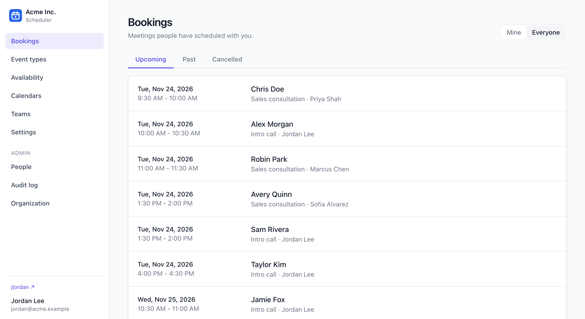
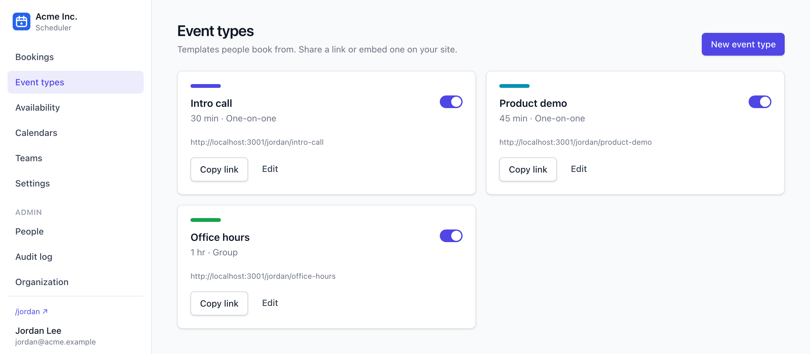
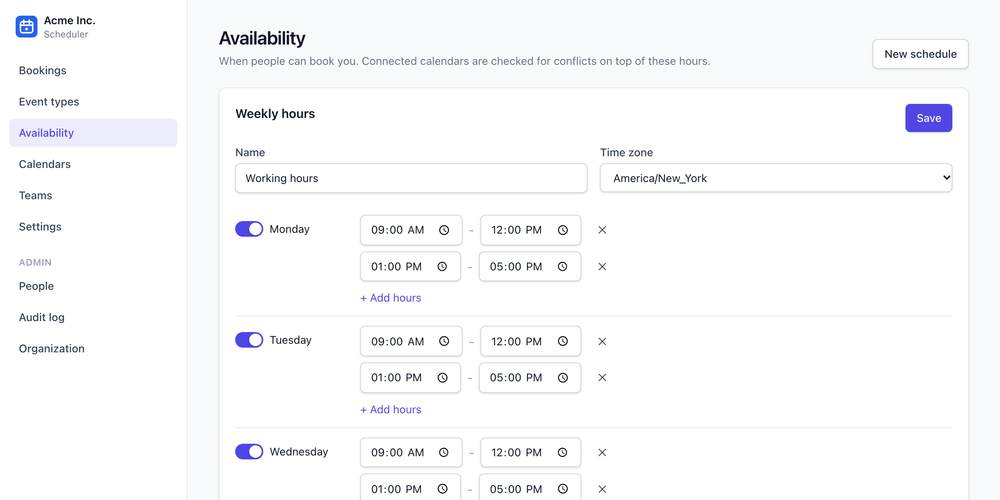
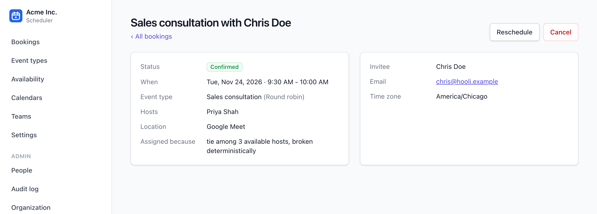
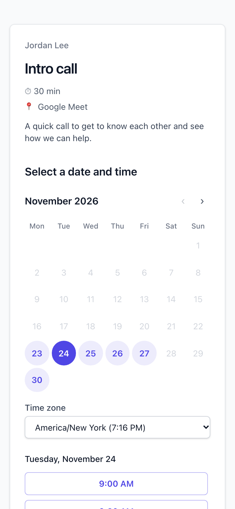
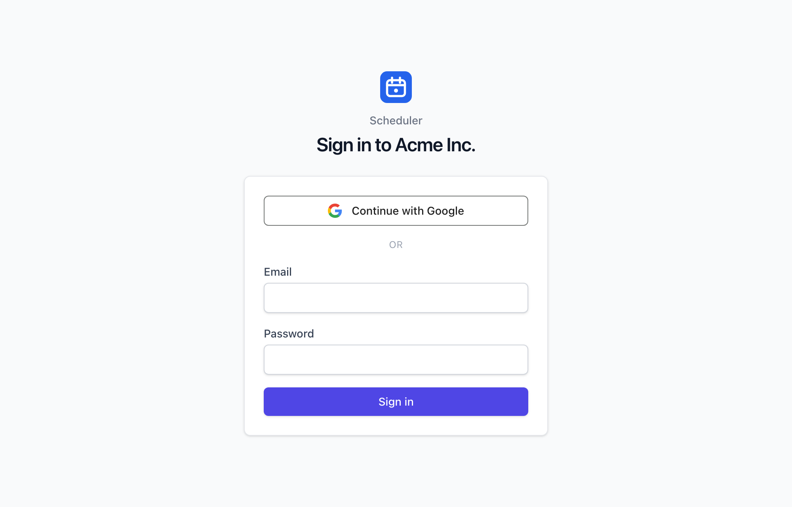
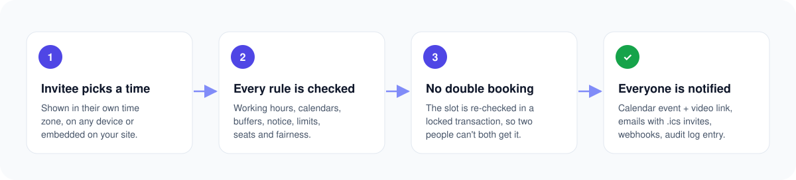
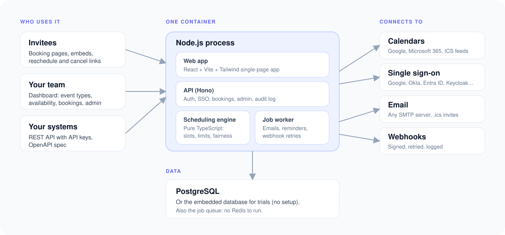

<p align="center">
  
</p>

<p align="center">
  <b>A self-hostable alternative to Calendly.</b> Booking pages, team scheduling, calendar sync, single sign-on,<br>
  an audit log, webhooks and a REST API. One container, your infrastructure, Apache-2.0.
</p>

<p align="center">
  <a href="https://github.com/karansingh-ai/calendar-scheduling/actions/workflows/ci.yml"></a>
  <a href="LICENSE"></a>
  
  
  
  <a href="#run-it-with-docker"></a>
  <a href="CONTRIBUTING.md"></a>
  <a href="https://github.com/karansingh-ai/oss-saas-factory"></a>
</p>

<p align="center">
  <a href="https://render.com/deploy?repo=https://github.com/karansingh-ai/calendar-scheduling"></a>
  &nbsp;
  <a href="https://codespaces.new/karansingh-ai/calendar-scheduling?quickstart=1"></a>
</p>

<p align="center">
  <a href="#-screenshots">Screenshots</a> ·
  <a href="#-features">Features</a> ·
  <a href="#-quick-start">Quick start</a> ·
  <a href="#-deploy-for-free">Deploy for free</a> ·
  <a href="#-sign-in-with-google-and-connect-calendars">Google sign-in</a> ·
  <a href="#-documentation">Docs</a>
</p>

---

## Why

Hosted schedulers keep the features companies actually need (single sign-on, audit logs, data residency) behind enterprise contracts, and keep every meeting in their cloud. Scheduler ships those controls in the open-source core, so any team can run it on its own infrastructure, in its own region, next to its own identity provider.

> "Scheduler" is a working name. Set `APP_NAME` to show your own product name in the UI and emails.

## 📸 Screenshots

<p align="center">
  
  <br><sub><b>Booking page</b>: invitees see open times in their own time zone and book in two clicks.</sub>
</p>

<table>
  <tr>
    <td width="50%"><br><sub><b>Bookings</b>: yours or the whole team's, upcoming, past and cancelled.</sub></td>
    <td width="50%"><br><sub><b>Event types</b>: one-on-one, group, collective and round robin.</sub></td>
  </tr>
  <tr>
    <td width="50%"><br><sub><b>Availability</b>: split hours, date overrides, any time zone.</sub></td>
    <td width="50%"><br><sub><b>Round robin you can explain</b>: every booking records why that host was picked.</sub></td>
  </tr>
  <tr>
    <td width="50%" align="center"><br><sub><b>Mobile friendly</b> booking pages.</sub></td>
    <td width="50%"><br><sub><b>Sign in with Google</b> or any OpenID Connect provider.</sub></td>
  </tr>
</table>

## ✨ Features

| | |
|---|---|
| 📅 **Scheduling** | One-on-one, **group** (seats), **collective** (everyone must be free) and **round-robin** event types. Round robin by priority or equal distribution with weights. Buffers, minimum notice, daily and weekly limits, rolling or fixed booking windows, custom questions. |
| 🔒 **No double booking** | Availability is re-checked inside a locked database transaction, so two people racing for the same slot can't both get it. |
| 🔍 **Explainable availability** | Ask the API why a time isn't bookable: `BUSY`, `BUFFER_CONFLICT`, `DAILY_LIMIT`, `FAIRNESS`… |
| 🗓️ **Calendars** | Google Calendar and Microsoft 365 (conflict checks, writes events, creates Google Meet and Teams links), plus any read-only ICS feed (iCloud, Fastmail, Proton). |
| ✉️ **Booking experience** | Personal and team pages, time zone detection, reschedule and cancel links, confirmation and reminder emails with `.ics` invites, website embed (inline or popup), redirect after booking. |
| 🛡️ **For IT and admins** | OpenID Connect SSO (Google, Okta, Entra ID, Keycloak…) with just-in-time provisioning and allowed domains, roles, teams, an **audit log** with CSV export, white-label branding. |
| 🔌 **Integrations** | Signed webhooks with retries and delivery logs, personal API keys, an OpenAPI spec. |
| 📦 **Simple to run** | One container plus PostgreSQL. No Redis. An embedded database for trials. |

### How a booking works

<p align="center">
  
</p>

## 🚀 Quick start

### Try it on your computer (no database needed)

Requires [Node.js](https://nodejs.org) 20.12 or newer.

```bash
git clone https://github.com/karansingh-ai/calendar-scheduling.git
cd calendar-scheduling
npm install
npm run build
npm start          # http://localhost:3000, data in ./data (embedded PostgreSQL)
```

Open <http://localhost:3000>, create the owner account, set your availability and create an event type. Until you configure SMTP, emails are printed to the console.

### Run it with Docker

```bash
cp .env.example .env
# Set APP_URL, ENCRYPTION_KEY (openssl rand -hex 32) and POSTGRES_PASSWORD
docker compose up -d
```

This starts the app and PostgreSQL. Put it behind your reverse proxy with HTTPS; the [self-hosting guide](docs/self-hosting.md) covers proxies, Kubernetes, backups and upgrades.

### Try it in the browser

<a href="https://codespaces.new/karansingh-ai/calendar-scheduling?quickstart=1"></a>

The Codespace installs everything, builds the app and starts it on port 3000 with the right public URL. Nothing to install locally.

## 🌍 Deploy for free

<a href="https://render.com/deploy?repo=https://github.com/karansingh-ai/calendar-scheduling"></a>

The button opens the [Render Blueprint](render.yaml): the app on Render's free web plan plus a free PostgreSQL database. The encryption key is generated for you, and the app uses its `onrender.com` address automatically.

Know the free-tier limits before you rely on it:

| | Free plan behavior | What to do |
|---|---|---|
| **Web service** | Sleeps after 15 idle minutes; the next visit takes about a minute to wake it. Reminder emails wait until it's awake. | Fine for trying it out. Use a paid instance for a team that depends on reminders. |
| **Database** | Render's free PostgreSQL expires after 30 days. | Point `DATABASE_URL` at a free [Neon](https://neon.tech) or [Supabase](https://supabase.com) database, or upgrade it. |
| **Email** | Not included. | Set `SMTP_URL` to any SMTP provider (many have free tiers). |

Anywhere that runs a container works too: one Docker image, PostgreSQL, and the variables in [configuration](docs/configuration.md).

## 🔑 Sign in with Google and connect calendars

One Google OAuth client powers both features.

1. In [Google Cloud Console](https://console.cloud.google.com), enable the **Google Calendar API** and configure the OAuth consent screen.
2. Create an **OAuth client ID** (*Web application*) with two redirect URIs:
   - `<APP_URL>/api/integrations/google/callback` (calendar connection)
   - `<APP_URL>/api/auth/oidc/callback` (sign in with Google)
3. Set the client's keys and turn on Google sign-in:

   ```bash
   GOOGLE_CLIENT_ID=...apps.googleusercontent.com
   GOOGLE_CLIENT_SECRET=...
   GOOGLE_SIGN_IN=true
   ```

4. Restart. The login page shows **Continue with Google**, and each person connects their calendar under **Calendars**.

> [!IMPORTANT]
> With Google sign-in on and no `ALLOWED_EMAIL_DOMAINS`, anyone with a Google account can create a member account. For a company deployment, set `ALLOWED_EMAIL_DOMAINS=yourcompany.com`. Details, plus Microsoft 365 and other SSO providers, are in [integrations](docs/integrations.md).

## 🧱 Architecture

<p align="center">
  
</p>

```
packages/core   Pure TypeScript scheduling engine: availability windows, slots, limits, seats,
                collective and round-robin logic. No I/O; heavily unit tested.
apps/server     Hono HTTP API on Node.js, Drizzle ORM (PostgreSQL or embedded PGlite),
                OIDC, calendar providers, email, webhooks, Postgres-backed job queue.
apps/web        React + Vite + Tailwind single-page app: booking pages and the dashboard.
```

One process serves the API, the web app and the background worker.

## 📚 Documentation

| Topic | Where |
|---|---|
| Production deployment, upgrades, backups, scaling | [docs/self-hosting.md](docs/self-hosting.md) |
| Every environment variable | [docs/configuration.md](docs/configuration.md) |
| Google, Microsoft and SSO setup | [docs/integrations.md](docs/integrations.md) |
| REST API, webhooks and embedding | [docs/api.md](docs/api.md) and `/api/openapi.yaml` |
| Architecture and contributing | [CONTRIBUTING.md](CONTRIBUTING.md) |
| Security model and reporting vulnerabilities | [SECURITY.md](SECURITY.md) |

## 🧪 Development

```bash
npm install
npm run dev        # API on :3000 with auto-reload, web app on :5173
npm test           # engine unit tests + full API integration tests (embedded PostgreSQL)
npm run typecheck
```

CI runs the tests against both the embedded database and PostgreSQL 16, then builds the Docker image.

## 🧭 Roadmap

Contributions are welcome on any of these:

- [ ] Routing forms (qualify and route leads to the right host or team)
- [ ] SCIM provisioning and directory group sync
- [ ] Zoom integration and CalDAV write support
- [ ] Workflows: SMS reminders and custom follow-ups
- [ ] Hosted MCP server so AI assistants can check availability and book
- [ ] Translations (i18n) and an accessibility audit
- [ ] Payments (Stripe) for paid sessions
- [ ] Helm chart

## 🤝 Contributing

Read [CONTRIBUTING.md](CONTRIBUTING.md). Run `npm test` and `npm run typecheck`, keep PRs focused, and sign off your commits (`git commit -s`, [DCO](https://developercertificate.org/)). There's no CLA. Report vulnerabilities privately as described in [SECURITY.md](SECURITY.md).

## 📄 License

[Apache License 2.0](LICENSE).

---

<p align="center">
  <sub>Part of <a href="https://github.com/karansingh-ai/oss-saas-factory"><b>OSS SaaS Factory</b></a>: open-source versions of everyday SaaS, built end to end with Claude.</sub>
</p>
